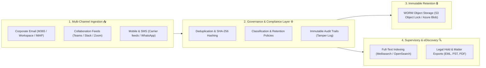

# Awesome-Compliant-Cloud-Information-Archiving 🛡️☁️

  <strong>Curated directory of enterprise SaaS platforms and open-source systems for Compliant Cloud Information Archiving, regulatory record preservation (SEC Rule 17a-4, FINRA, MiFID II, HIPAA, GDPR), immutable WORM retention, eDiscovery, and supervisory review.</strong>

---

## 📑 Table of Contents
- [📊 Sector Overview & Market Dynamics](#-sector-overview--market-dynamics)
- [🏢 Enterprise SaaS & Hosted Platforms](#-enterprise-saas--hosted-platforms)
- [💻 Open-Source GitHub Projects](#-open-source-github-projects)
- [🏗️ Architecture & Implementation Guidelines](#️-architecture--implementation-guidelines)
- [🤝 How to Contribute](#-how-to-contribute)
- [⭐ Star History](#-star-history)
- [💖 Support & Sponsorship](#-support--sponsorship)
- [⚖️ Disclaimer](#️-disclaimer)

---

## 📊 Sector Overview & Market Dynamics

The global enterprise information archiving (EIA) and compliant cloud communications governance market is valued between **$9.5 billion and $11 billion**, projected to grow at a **11%–14% CAGR** to exceed **$25 billion by the 2030s** 📈. The sector is **moderately fragmented**: enterprise infrastructure conglomerates (OpenText, Commvault) and heavily capitalized pure-play compliance vendors (Proofpoint, Veritas, Smarsh, Mimecast) dominate high-stakes financial and legal tiers 🏦, while intensifying regulatory scrutiny over collaboration tools (Microsoft Teams, Slack, WhatsApp, Zoom) continuously sustains specialized point solutions and emerging open-source archiving engines 🚀.

---

## 🏢 Enterprise SaaS & Hosted Platforms

Enterprise SaaS solutions sorted descending by company scale (market valuation / annual revenue run-rate):

| Product | Company Scale (Valuation / Revenue) | Description | Starting Pricing | Free Tier / Trial Limits |
|---|---|---|---|---|
| **[Proofpoint Enterprise Archive](https://www.proofpoint.com/)** 🛡️ | **~$12.3B valuation** (Acquired by Thoma Bravo; ~$1.5B ARR) | Enterprise email and multi-channel compliance archiving platform with SEC/FINRA supervisory review, automated legal holds, and ML-assisted eDiscovery. | **$5.00/user/month** (via Proofpoint Essentials Pro / reseller framework; Enterprise tier custom quote) | **No free trial** (0 days; guided interactive sandbox demo via sales) |
| **[Commvault Cloud Archive](https://www.commvault.com/)** ☁️ | **~$7.2B market cap** (~$1.2B revenue; NASDAQ: CVLT) | Unified data protection and cyber resilience suite providing automated file, object, and messaging compliance archiving with eDiscovery search. | **$1.70/user/month** (Microsoft 365 Standard; $4.50/user/month with Compliance Search; capacity from $90/TB/month) | **30-day free trial** (Full platform functionality across hybrid/SaaS workloads; no credit card required) |
| **[Veritas Enterprise Vault](https://www.veritas.com/)** 🏛️ | **~$7.0B valuation** (~$1.5B revenue; Cohesity merger) | Pioneer enterprise information archiving suite spanning email, SharePoint, and cloud files with immutable WORM retention and classification engines. | **$5.01/user/month** (Enterprise Vault.cloud base tier; ~$6.45/user/month for Enhanced Supervision) | **30-day free trial** (Evaluation license for cloud/virtual appliance available via sales request) |
| **[OpenText InfoArchive](https://www.opentext.com/)** 📂 | **~$6.2B market cap** (~$5.2B revenue; NASDAQ: OTEX) | Unified enterprise compliance archive designed for active application decommissioning, big data structured record retention, and unstructured content management. | **~$2,574/month** (£30,888/year per Terabyte capacity block on public cloud procurement frameworks) | **No free trial** (0 days; scoped guided Proof of Concept / FasTrak pilot available via sales) |
| **[Mimecast Cloud Archive](https://www.mimecast.com/)** ✉️ | **~$5.8B valuation** (Acquired by Permira; ~$600M+ ARR) | Cloud-native email security and compliance archiving system maintaining triplicate immutable encrypted copies across independent data centers. | **$14.90/user/month** (Flat rate per user starting tier via direct listings) | **No free trial** (0 days; zero self-serve free trial; guided enterprise proof-of-concept on request) |
| **[Barracuda Message Archiver](https://www.barracuda.com/)** 🐟 | **~$4.0B valuation** (Acquired by KKR; ~$500M+ revenue) | Dedicated email archiving appliance (hardware, virtual, or cloud) featuring integrated message deduplication, role-based eDiscovery, and mobile access. | **$2.70/user/month** (Cloud Archiving service; physical/virtual appliances start at flat per-device licensing from ~$2,199) | **14-day free trial** (Full virtual appliance / cloud evaluation with live mailbox sync; no credit card required) |
| **[Smarsh](https://www.smarsh.com/)** 💬 | **~$2.5B–$3.0B valuation** (K1 Investment Management; ~$350M ARR) | Specialized digital communications compliance platform capturing 100+ channels including Microsoft Teams, Slack, WhatsApp, SMS, and financial voice feeds. | **$75.00/month** (Base entry-tier account minimum starting price) | **No free trial** (0 days; no public free plan; live customized compliance demo via sales) |
| **[Druva Data Resiliency Cloud](https://www.druva.com/)** 🔄 | **~$2.0B valuation** (Privately held unicorn; ~$200M+ ARR) | 100% SaaS-based data protection and information governance platform with built-in legal hold, compliance monitoring, and federated search across endpoints and M365. | **$8.00/user/month** (Druva inSync Enterprise governance tier; consumption credits for cloud server workloads) | **30-day free trial** (Full enterprise functionality with endpoint & cloud workload backup; no credit card required) |
| **[Global Relay Archive](https://www.globalrelay.com/)** 🌐 | **~$1.5B–$2.0B valuation** (Bootstrapped/profitable; ~$200M revenue) | Market-leading compliance archive engineered specifically for global investment banks, hedge funds, and broker-dealers requiring FINRA/SEC books and records compliance. | **$5.00/user/month** (Base user connector pricing via partner procurement listings; custom enterprise minimums) | **No free trial** (0 days; no self-serve free plan; formal compliance workflow demonstration via sales) |
| **[ZL Technologies (ZL Tech)](https://www.zlti.com/)** 🔍 | **~$100M–$200M valuation** (Privately held; ~$50M–$80M revenue) | Massive-scale unified records governance architecture managing multi-petabyte compliance, eDiscovery, and privacy queries against a single centralized data repository. | **$3.50/user/month** (Estimated baseline enterprise licensing on multi-year Fortune 500 deployments) | **No free trial** (0 days; structured enterprise Proof of Concept / sandbox pilot on qualified sales request) |

---

## 💻 Open-Source GitHub Projects

Self-hosted, transparent, and sovereign platforms for compliant email archiving, legal holds, eDiscovery, and document preservation. Sorted descending by GitHub stargazers count:

| Project | Stars | Language / Tech Stack | Primary Capabilities |
|---|:---:|---|---|
| **[paperless-ngx](https://github.com/paperless-ngx/paperless-ngx)** 📄 |  | Python / Django / TypeScript | Community-driven document archiving system with multi-language OCR, automated tag extraction, full-text indexing, and secure local/S3 persistence. |
| **[OpenArchiver](https://github.com/LogicLabs-OU/OpenArchiver)** 📬 |  | TypeScript / SvelteKit / Node.js / Meilisearch | Self-hosted, legally compliant email archiving and eDiscovery engine. Ingests Google Workspace, Microsoft 365, IMAP, and PST files with SHA-256 tamper-evident integrity reports and audit logging. |
| **[mail-archiver](https://github.com/s1t5/mail-archiver)** 🗃️ |  | C# / .NET / PostgreSQL | High-performance multi-account mail archiving application featuring automated folder synchronization, immutable deletion lock (`DeletionAllowed=false`), and audit logging. |
| **[bichon](https://github.com/rustmailer/bichon)** ⚡ |  | Rust / SQLite / WebUI | Ultra-fast, lightweight email archiving daemon engineered in Rust. Provides near-instant full-text search, low memory consumption, and standalone container deployment. |
| **[piler](https://github.com/jsuto/piler)** 🗄️ |  | C / PHP / Manticore Search | Enterprise-grade email archiving application with built-in SMTP daemon, automated deduplication, digital signatures, legal hold management, and compliance retention periods. |
| **[FreeEed](https://github.com/shmsoft/FreeEed)** 🔎 |  | Java / Apache Tika / Lucene | Open-source eDiscovery, digital forensics, and legal search platform supporting 1,400+ formats (PST, MSG, PDF, Office) with automated OCR and redaction tools. |

---

## 🏗️ Architecture & Implementation Guidelines

For engineering, legal operations, and security teams designing internal archiving architectures:

### 💡 Self-Hosted Architecture Recommendation
Organizations seeking zero SaaS lock-in and strict data sovereignty can combine:
- **Ingestion & Archive:** [OpenArchiver](https://github.com/LogicLabs-OU/OpenArchiver) or [piler](https://github.com/jsuto/piler) via journaled SMTP or Microsoft 365 / Google Workspace API sync 📬.
- **Storage Tier:** MinIO or AWS S3 configured with **WORM (Write Once, Read Many) Object Lock** in Compliance Mode 🗄️.
- **eDiscovery & Forensics:** [FreeEed](https://github.com/shmsoft/FreeEed) for advanced multi-format document extraction, keyword tagging, and litigation exports 🔎.

---

## 🤝 How to Contribute

1. Fork this repository 🍴.
2. Add or update entries in `README.md` maintaining table formatting, specific starting prices, accurate star badges, and stargazers links 📝.
3. Ensure open-source projects are relevant to email archiving, eDiscovery, record retention, or information governance 🔍.
4. Submit a Pull Request with a brief explanation of the change 🚀.

---

## ⭐ Star History

---

## 💖 Support & Sponsorship

Thank you for exploring and using this repository! If you find this curated ecosystem resource helpful for your organization, compliance research, or infrastructure design, please consider showing your support:

- ⭐ **Star this repository** to help others discover it on GitHub.
- 🍴 **Fork and share** with colleagues in legal ops, IT governance, and engineering teams.
- ☕ **Sponsor or Buy a Coffee:** Support ongoing maintenance and curation via the [GitHub Sponsor Dashboard](https://github.com/sponsors/ishandutta2007) 🙏.

Your sponsorship and contributions keep this repository accurate, transparent, and up-to-date!

---

## ⚖️ Disclaimer

- This repository is a **community-curated index** and does not constitute formal legal or regulatory advice.
- Regulated organizations subject to **SEC Rule 17a-4**, **FINRA Rule 4511**, **CFTC Rule 1.31**, **MiFID II**, or **HIPAA** must independently audit solutions to ensure immutable WORM retention, non-erasable write modes, dual third-party representation, and audit logging.
- Pricing metrics, valuations, and star counts are verified as of 2026 and subject to vendor updates.
